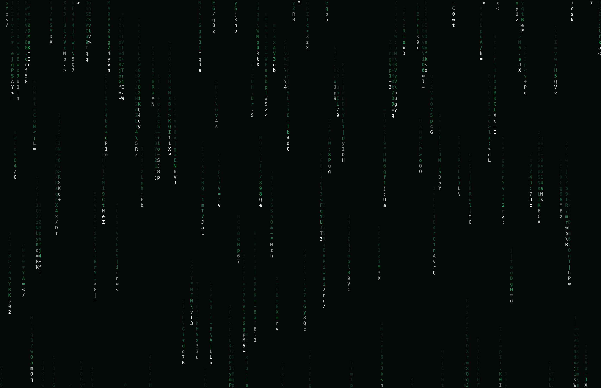
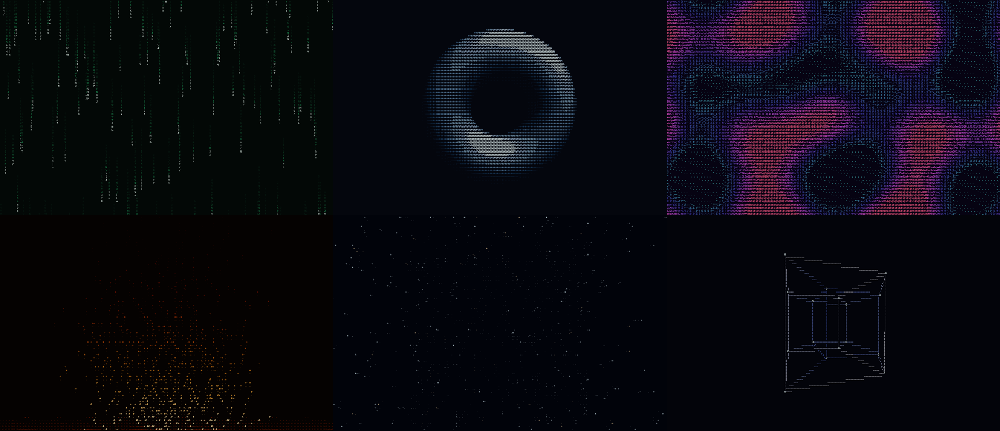
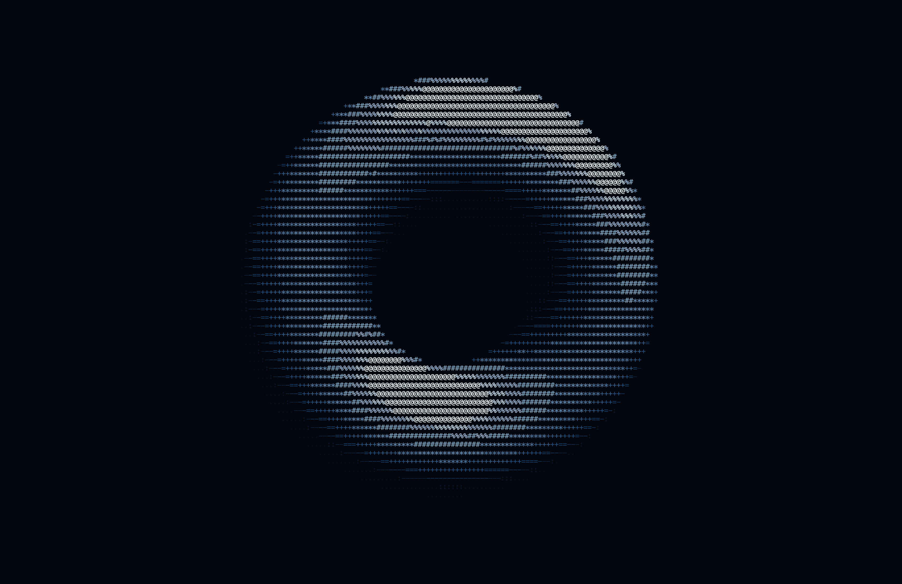
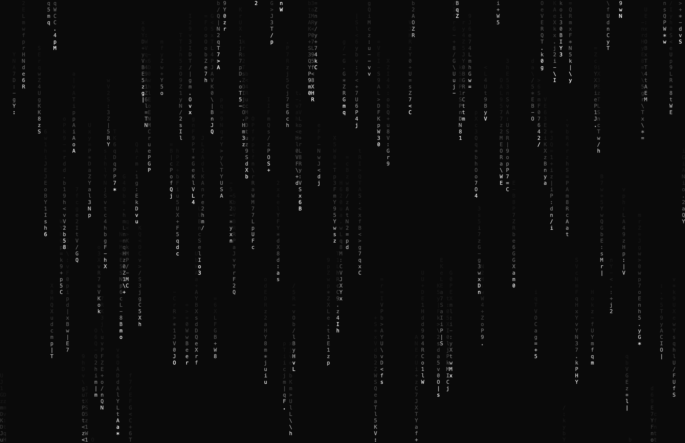

# ASCII Wallpaper

Animated ASCII wallpapers for macOS. A full-screen field of characters lives at the
desktop level: above the system wallpaper, below Finder icons, and behind regular
windows. Clicks pass through to the desktop.





## Features

- Six procedural scenes: Matrix, Donut, Plasma, Fire, Stars, Hypercube.
- Monospaced CoreText rendering (Menlo) with glyph batching by colour and alpha.
- Fade transitions between scenes and optional auto-rotation (off by default).
- Monochrome mode: render any scene in white, amber, green or ice.
- Menu bar item: pick a scene, next scene, toggle auto-cycling, pause, quit.
- Pauses when the display sleeps or the session locks; works across multiple displays.
- Single instance: launching again with `--scene` switches the running wallpaper.

## Requirements

- macOS 14 or newer (built and tested on macOS 27).
- Xcode Command Line Tools: `xcode-select --install` (provides `swiftc`).
- Retina and multi-display setups are supported.

## Quick start

```bash
cd ~/asciiwallpaper
./build.sh          # build build/AsciiWallpaper.app
./run.sh            # start the wallpaper
```

An `Aa` icon appears in the menu bar. To stop:

```bash
./stop.sh
```

Start with a specific scene:

```bash
./run.sh --scene fire
```

## Controls

Menu bar item:

- scene list with a checkmark on the current one;
- "Next scene";
- "Auto-cycle" on/off;
- "Pause";
- "Monochrome" submenu: Off, White, Amber, Green, Ice;
- "Quit".

While the app runs it covers the system wallpaper with its own window. No desktop
settings are changed: quitting the app brings the previous wallpaper back.

## Scenes

| Scene | What happens |
|---|---|
| `matrix` | green character rain with bright heads and fading trails |
| `donut` | a classic 3D torus, rotating and tilting, with highlights and shading |
| `plasma` | colourful interference waves rendered as character gradients |
| `fire` | sparks and glowing embers rising from the bottom |
| `stars` | a perspective star field with subtle trails |
| `hypercube` | a rotating 4D tesseract projection drawn with ASCII lines |

Previews live in `preview/` and are rendered by the same engine that draws the
wallpaper (see `--render` below).



### Monochrome

Any scene can be rendered in a single tint, for example pure black and white.
Pick a tint in the menu bar or pass `--mono` on the command line: `white`
(grayscale), `amber`, `green` or `ice`. The choice is remembered between launches.



## Command line

```bash
BIN=build/AsciiWallpaper.app/Contents/MacOS/AsciiWallpaper

$BIN --list                        # list scenes
$BIN --scene plasma                # switch the running wallpaper (or start with it)
$BIN --fps 15                      # fewer frames, less battery drain
$BIN --font-size 12                # smaller grid, more characters
$BIN --cycle 60                    # auto-cycle every 60 seconds (off by default)
$BIN --mono                        # black and white
$BIN --mono amber                  # monochrome amber tint
$BIN --no-mono                     # back to full colour
$BIN --no-menu                     # no menu bar icon
$BIN --quit                        # stop the running instance
$BIN --help
```

Debug helpers:

```bash
# render a scene frame to PNG (same font and renderer as the wallpaper)
$BIN --render preview/plasma.png --scene plasma --time 6 --cols 218 --rows 69 --scale 2

# measure update and draw time for every scene
$BIN --benchmark --cols 218 --rows 69
```

## Install and autostart

```bash
./install.sh
```

The script copies the app to `~/Applications/AsciiWallpaper.app`, creates the
`ru.disa.asciiwallpaper` LaunchAgent in `~/Library/LaunchAgents`, and starts it. It
should come back automatically after the next login. The last scene and monochrome
tint are restored; auto-rotation stays off unless you enable it.

If the system does not allow `launchctl` (managed or sandboxed sessions), the script
still installs and starts the app and suggests adding it manually:

> System Settings → General → Login Items → "+" → `~/Applications/AsciiWallpaper.app`

Remove the installed copy and the login item (the project folder stays):

```bash
./uninstall.sh
```

## How it works

- For each display the app creates a borderless `NSWindow` at
  `CGWindowLevelForKey(.desktopWindow)` (`-2147483623`): above the system wallpaper
  and below Finder icons. The window never takes focus and ignores the mouse.
- `collectionBehavior` is `canJoinAllSpaces`, `stationary`, `ignoresCycle`: the
  wallpaper is visible on every Space and stays out of the window switcher.
- A frame is a `cols × rows` character grid (218×69 cells on a 1706×1109 pt screen).
  The scene fills a `Canvas` buffer with a glyph, colour and alpha per cell.
- The renderer groups cells by quantised colour and alpha level and draws each group
  with a single `CTFontDrawGlyphs` call instead of tens of thousands of separate calls.
- A 24 fps timer drives the animation; rendering pauses when the display sleeps or the
  session is locked.
- In monochrome mode the renderer maps each colour's luminance onto a single tint
  before batching the glyphs.

## Performance

Measured on this machine (218×69 cells, 3412×2208 px frame, 13 pt font):

```
scene       update     draw    total
matrix       0.05 ms   2.60 ms  2.65 ms
donut        0.98 ms   2.08 ms  3.06 ms
plasma       0.45 ms   6.66 ms  7.11 ms
fire         0.06 ms   1.08 ms  1.14 ms
stars        0.04 ms   0.89 ms  0.92 ms
hypercube    0.02 ms   0.70 ms  0.72 ms
```

That is well under the 41 ms frame budget at 24 fps. For something quieter and
cheaper, use `--fps 12` or `--font-size 11`.

## Troubleshooting

- **The wallpaper is not visible.** Check that the process is alive:
  `pgrep -fl AsciiWallpaper`. There should be a menu bar icon. Startup log:
  `build/run.log`.
- **A second launch does nothing.** That is expected: the app is single-instance and
  forwards `--scene` / `--quit` to the running copy.
- **Desktop icons disappeared.** Finder draws them at a higher window level. If they
  are gone, check Finder settings.
- **Full-screen apps.** The wallpaper window stays behind a full-screen app, by design.
- **Autostart did not work.** See the install section and Login Items.
- **Want the old wallpaper back?** Run `./stop.sh` or choose "Quit" in the menu.

## Uninstall

```bash
./uninstall.sh   # removes the login item, the copy in ~/Applications and scene prefs
```

The `~/asciiwallpaper` folder itself can be deleted manually: it only contains sources,
scripts and previews.

## Notes

Previews are offscreen renders from the same engine; capturing the live desktop requires
Screen Recording permission.
